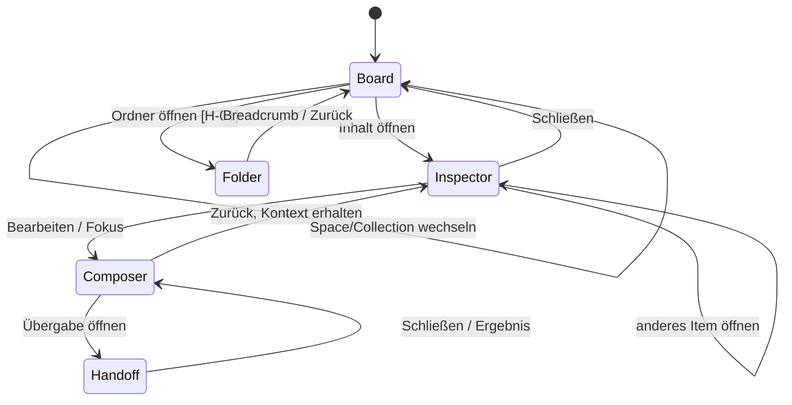
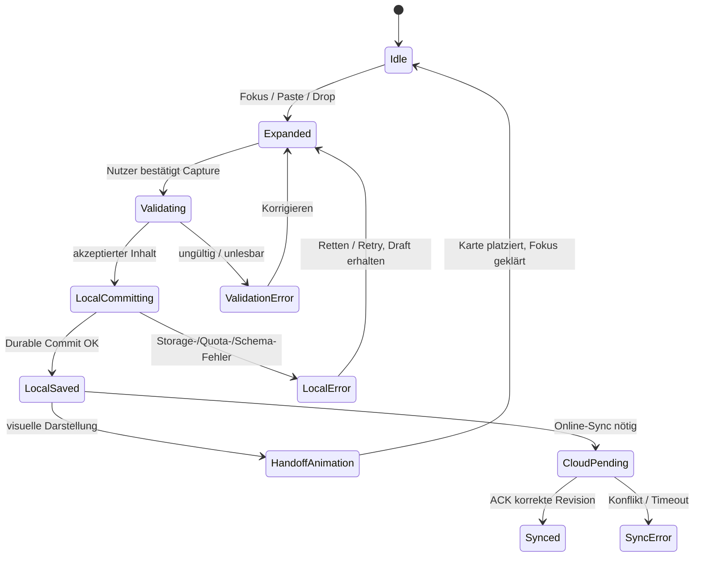
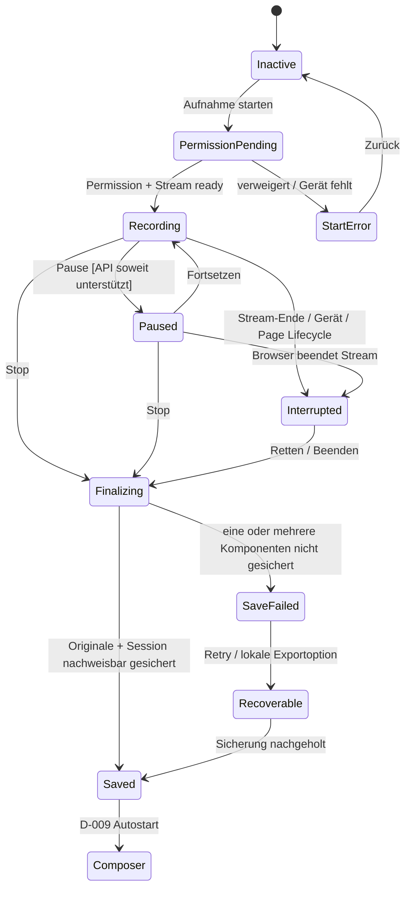

# CopyBoard — Interaction Contract & Motion State Machines Blueprint 03

**Stand:** 21. Oktober 2026  
**Artefakt:** Consolidation Phase 03 · `IM-03` · Konzept-Spezifikation  
**Quellen:** `CopyBoard-Design-Masterplan-v0.35-2026-10-21.md`; `CopyBoard-Screen-Inventory-IA-Blueprint-02-2026-10-21.md`; `CopyBoard-Decision-Integrity-Audit-01-2026-10-21.md`.  
**Status:** Entwurf für Design-/Architekturabnahme; **keine Implementierungs-, Repository- oder Deploymentfreigabe**. Echte Persistenz, Browser-APIs und technische Umsetzbarkeit wurden in diesem Run **nicht** gegen den Quellcode getestet.

> **Entscheidungsschutz:** D-001 bis D-033 bleiben normativ. Dieser Blueprint fügt **keine D-034** und keine unbemerkte neue Nutzerentscheidung hinzu. `[FIX]` = direkte Ableitung bereits gewählter Richtung; `[DESIGN PROPOSAL]` = fachlich empfohlene, noch nicht bestätigte Ausführungsregel; `[HUMAN GATE]` = bewusste Nutzerabnahme erforderlich; `[TECH GATE]` = mit Code-/Browser-/Datenbanknachweis zu überprüfen. Diese Marker gelten für Tabellen und Diagramme mit.

## 0. Executive Contract

**Arbeitsmetapher:** ein persistenter Workspace; Spaces First (D-018), Smart Capture (D-003), Smart Grid/Liste (D-005), Inspector (D-004), Hybrid Composer (D-007), Context Rail (D-010), Session (D-008) und Smart Handoff (D-011) als ineinandergreifende Zustände. Mobile benutzt denselben fachlichen Vertrag, mit Drawer/Sheets und Adaptive Mobile Dock (D-030).

**Unverletzbare Invarianten** (Kennung `INV-*`; als Akzeptanzanker für spätere Runs):

| ID | Invariante | Ursprung |
|---|---|---|
| INV-01 | **Eine Eingabe → genau ein beabsichtigter Aktionseigentümer.** Paste in aktivem Editor/Suchfeld wird nicht gleichzeitig global zu Capture. | D-003/007/021, P0-05 |
| INV-02 | **Write-Truth:** „lokal gesichert“ nur nach belastbarem lokalem Commit; „Cloud synchron“ nur nach bestätigtem ACK der richtigen Revision; jedes Fehlersignal darf weder verschluckt noch grün animiert werden. | D-026/027/028, P0-01 |
| INV-03 | **Keine stille Datenvernichtung:** unsichere Navigationsabbrüche, fehlgeschlagene Saves, Recorder-Stop, Revisions-Restore und Trash berücksichtigen die vorhandenen Originale, nicht nur UI-Zustände. | D-008/009/029, P0-02/04 |
| INV-04 | **Recorder-Lebensdauer ist vom aktuellen Screen unabhängig.** Öffnen/Schließen von Panel/Palette, Space-Wechsel oder Inspector-Wechsel stoppen keine laufende Aufnahme. | D-008/030 |
| INV-05 | **Keine zwei konkurrierenden rechten Arbeitsspalten:** normaler Inspector oder fokussierter Composer mit optionaler Context Rail; nicht beides zugleich. | D-004/007/010 |
| INV-06 | **Content-IDs statt Visual-Indices:** Auswahl, Sortierung, Undo, Restore und Referenzen bleiben an stabile IDs gebunden. | D-022/023/024/029/032 |
| INV-07 | **Funktion vor Animation:** Transition darf nicht Fokuseingaben blockieren, Actions doppelt ausführen, Layout verschieben, Datenversprechen vorwegnehmen oder Reduced Motion von Informationen abschneiden. | D-017/020/027 |
| INV-08 | **Globales System, lokale Anmutung:** Mobile Dock, Smart Capture und optionales Floating Desktop Dock bedienen dieselbe Capture-Domäne; Quick Preferences/Studio dieselbe Preference-Quelle. | D-003/030/033 |
| INV-09 | **Kontext- und Sicherheitsgrenzen:** Handoff überträgt keine Binärdaten mit Text-Copy und sendet nichts ungefragt an externe Agenten; Fehler/Sicherheitszustände werden textuell erklärt. | D-011/028, P0-05 |
| INV-10 | **Offene Entscheidungen bleiben offen** (insbesondere Folder-Primärklick, Shortcut-Konflikte und Persistenz-Scope), bis explizit freigegeben. | IA H-01..03 |

**Trennung der Zustandsarten:** Domain-State ist autoritativ (Items/Session/Revision/Account); View-State ist projektiert (aktive Ansicht/Panel/Sortierung); Animation-State ist ausschließlich Darstellung. Eine laufende Animation darf niemals als Datenquelle gelten.

## 1. Ereignisse, Eigentümer und Prioritätskaskade

### 1.1 Scope und Kontrollinhaber

| Scope | Besitzt | Darf NICHT besitzen | Lebensdauer |
|---|---|---|---|
| App Shell | Session/Auth-Boundary, aktiven Navigationskontext, Portal-/Layer-Host | Inhalt als impliziten, unbestätigten Save | App-Laufzeit |
| Board/Collection | Grid/Liste, Filter, Auswahl IDs, Scrollanker, Dichte, Sortier-Präsentation | Audioaufnahme, Composer-Text | Ansicht, bei Navigation gezielt rehydrierbar |
| Item Inspector | angezeigte Item-ID, Preview, Detailaktionen | zentrale Capture-Verarbeitung; Composer-Rail | Detailkontext |
| Composer | Draft-ID, Text/Caret/Undo-Stack, Source/Preview/Split, Assetbezüge | globales Paste außerhalb eigenen Fokus | Draft-Lebensdauer über Panelwechsel |
| Recorder | Session-ID, Segmentstatus, zeitrelativen Attachment-Index, MediaStream-Lifecycle | aktiven Space oder Modal-Fokus | Aufnahmesitzung, unabhängig von Screen |
| Persistence/Sync | konkrete Commit-/ACK- und Revisionsnachweise | optimistische UI-Animation als Bestätigung | asynchroner Domain-State |
| Recovery | Trash-Lifecycle, Versionslisten, bewusste Restore-Aktion | ungesicherte Löschung der aktuellen Revision | persistenter Domain-State |
| Preferences | ein kohärenter Einstellungsdatensatz je später festgelegtem Scope | getrennte Quick-/Studio-Datensilos | gespeicherter Preference-Scope |
| Layer Manager | Fokusfalle, Return-Focus, Escape-/Back-Routing, visuellen Stack | Bearbeitungsstand oder Session-Stop als Nebenwirkung | Shell |

### 1.2 Event-Routing (Priorität, `[DESIGN PROPOSAL]`)

1. **Native, fokussierte Eingabe** (Textarea, Markdown-Codeeditor, Contenteditable, Filter/Suche, Datei-Upload): Texttippen, Standard-Paste, Auswahl, Undo und IME gehören zuerst ihr. Nur absichtlich unterstützte globale Shortcuts dürfen hier abweichen.
2. **Aktive modale Aufgabe**: Confirmation/Conflict/Handoff/Space Sheet fängt ihre eigenen Tastendrücke, Enter und Escape; keine Events zu Board dahinter.
3. **Offene globale Palette**: deren Treffer, Commands, Pfeiltasten und Escape; keine heimlichen Mutationen ohne explizite Action.
4. **Offenes Kontextmenü oder Popover**: eigene Menünavigation, Escape schließt aktuelle Ebene.
5. **Fokusierte Board-/Inspector-Aktion**: Karten öffnen, kopieren, auswählen, Drag-Handle, Kontextmenü – getrennt nach Pointer-, Keyboard- und Touch-Intent.
6. **Globaler Workspace ohne Eingabefokus**: Capture-Paste, Smart Search Trigger und globale Navigation.

**Propagation-Gate:** Ereignis kann exakt einen geschäftlichen Effekt erzeugen. Wird beispielsweise das Textfeld im Composer eingefügt, darf es keinen zweiten Capture-Item-Write geben. Systemweite Paste außerhalb eines Feldes bleibt ein separater expliziter Einstieg. **Browser-Clipboard-Permissions und Datenformate bleiben `[TECH GATE]`.**

### 1.3 Aktionsbegriffe

| Nutzerintention | Desktop | iPhone/Touch | Abbruch/Feedback |
|---|---|---|---|
| Item **öffnen** | Card-Body Enter/Click, sofern keine Direktaktion | Tap Card-Body | Inspector oder für Folder **H-01 offen** |
| Item **kopieren** | sichtbare Hover-/Fokus-Copy-Aktion | sichtbare Copy-Aktion oder Menü | Copy-Erfolg nur nach Clipboard-Bestätigung; Binärdatei ggf. Download |
| Item **auswählen** | Auswahlbutton oder Modifier/Shift-Range | expliziter Auswahlmodus | Selection-Bar; keine implizite Inspector-Öffnung |
| Item **reordern** | Drag-Handle in manuellem Modus, Tastaturalternative | zugänglicher Move-Flow | Cancel/Drop-Reject; Reihenfolge nur nach bestätigtem Persistieren |
| Item **verschieben** | Move-Command oder Drop auf gültiges Ziel | Move-Sheet / Zielauswahl | kein Zyklus, Undo/Feedback |
| Item **Details** | `…` bzw. Kontextaktion | `…` / Sheet | keine Änderung des Zielordners |
| **Space wechseln** | Sidebar, Suche, Breadcrumb-Routing | Drawer/Dock | Draft/Recorder bleiben erhalten; View-State wird gewechselt |
| **Search** | Trigger, später bestätigter Shortcut | Trigger im Header/Dock | Palette/Full-Screen, Fokus zurück |

**H-01:** Für Ordnerkarten ist der konkurrierende Primär-Click (Inspector oder direkt Ordner) **nicht endgültig entschieden**. Designempfehlung: Öffnen des Ordners; Informationen separat über `… > Informationen`. Bis Abnahme muss jedes UI-Demo-/QA-Konzept beide möglichen Verhaltensweisen unterscheiden. Kein Codeauftrag aus dieser Empfehlung ableiten.

## 2. Formalisierte Zustandsautomaten

### 2.1 SC-02/03 — Navigation, Detail und Composer (`SM-01`)

**Vertrag:** Der normale Inspector wird bei Composer-Fokus nicht zusätzlich als zweite rechte Spalte eingeblendet; dessen Item-Kontext bleibt intern referenzierbar. Back stellt Board-Scrollanker, Space und ggf. Inspector-Item wieder her, sofern ID noch zugänglich. Deep-Link/Browser-Back bei nicht gespeichertem Draft: kein stillem Datenverlust dienender Pop.

| Current | Event | Precondition | Next | Fokus/History | Status |
|---|---|---|---|---|---|
| Board | Open card | Item vorhanden, nicht in Selection Mode | Inspector(itemId) | Fokus auf sinnvollen Detailtitel/erste Action; Board-Scroll erhalten | `[FIX]` |
| Board | Open folder card | Folder vorhanden | Folder(folderId) | Breadcrumb, Fokus auf Ordnerüberschrift | `[HUMAN GATE H-01]` |
| Inspector | Edit | editierbarer Typ | Composer(draftId, itemId) | Editor/Caret nach Kontext; Inspector-Layer suspendieren | `[FIX]` |
| Composer | Back | Draft vor Verlust gesichert oder explizit abgesichert | Inspector/Board | Editor-Caret im Draft persistiert, Fokus-Restoration | `[DESIGN PROPOSAL]` |
| Composer | Open Handoff | kein irreversibler Draft-Verlust | Handoff Sheet | Fokus im Sheet, Rücksprung zum Auslöser | `[FIX]` |
| Any | Target deleted/permission revoked | Item nicht mehr zugänglich | Recovery-/Fehleransicht | Nachricht statt leerem Inspector | `[DESIGN PROPOSAL]` |

### 2.2 SC-03/09/27 — Capture & Spatial Handoff (`SM-02`)

**Wichtig:** `LocalSaved` und `CloudPending` sind **separate, parallel verfolgbare Persistenzsignale** – Animation und Cloud-Sync sind nicht sequenziell voneinander abhängig. Das Diagramm ordnet ausschließlich die Capture-Präsentation, **nicht** den gesamten Revisionsautomaten. Beim Validierungs-/Storage-Fehler kein grüner Haken, kein „Neue Karte“-Morphing. Eine lokale Karte darf als lokal gesichert sichtbar sein, während Sync offen aussteht. Kein automatisch verschwundener Nutzerinhalt bei wiederholtem Paste/Retry.

**Spatial Handoff `[FIX D-027 + PROPOSAL]`:** (1) Bar reagiert auf Eingabe; (2) nach bestätigtem lokalem Commit wird Zielposition im aktuellen Board berechnet; (3) Preview springt als bewusst transformiertes Shared Element zur realen Position; (4) Grid-Nachbarn machen Platz ohne massives Reflow; (5) Zielkarte bestätigt sich mit kurzen Overshoot/Settling und eintextlichem „Lokal gesichert“/Undo; (6) bei sortierender/virtueller/offscreen Zielposition statt erzwungener Flugroute eine in-place Einblendung mit „Im Space gespeichert“ und optional „Anzeigen“. Der Flow **darf nicht die manuelle Sortierung oder Filter** verändern, nur um eine Animation sichtbar zu machen.

**Batch:** pro Batch nur ein konsolidierter Handoff mit `n` Items; bei mehreren Sortierpositionen keine n konkurrierenden Flugbahnen. **Komplexe Paste-Fälle:** reiner Text, HTML, Bild, mehrere Dateien, Browser-Clipboard-API nicht als identisch verfügbar annehmen.

### 2.3 SC-15/16/25 — Board-Selection, Drag, Reorder und Move (`SM-03`)

| State | Event | Folge | Risiko/Absicherung |
|---|---|---|---|
| Browse | Select Mode / Modifier | Selecting(ids) | Click öffnet nicht zusätzlich Inspector |
| Selecting | Tap/Click Item Checkbox | Selecting(updatedIDs) | IDs statt Indices, sichtbares Feedback |
| Selecting | Range Selection | Selecting(visibleRange) | aktuelle Filter-/Sortier-Reihenfolge bestimmt Range; virtuelle Items beachten |
| Selecting | Bulk Action | BulkConfirm/Running | Scope zeigt Gesamtauswahl und verborgene Auswahl, ggf. expliziter Prompt |
| Selecting | Clear | Browse | Fokus auf auslösende Karte/Toolbar, nicht Screen-Anfang |
| Browse+Manual Sort | Reorder Handle Start | Dragging(itemId) | Greifen ≠ Öffnen ≠ Kopieren |
| Dragging | Drop on same collection | LocalReorderPending | manuelle Ordnung erst mit Commit; bei Fehler rollback plus Explain |
| Dragging | Drop on Folder | MoveTargetCheck | Zielprüfung, kein Kreislauf, Pfad/Assets erhalten |
| Dragging | Escape/Cancel/outside | Browse | Preview zurück, kein Write |
| Browse+Auto Sort | Reorder Start | Nicht automatisch umordnen | Wechsel zu „Manuell“ nur mit expliziter Entscheidung |

**Keyboard-Alternative `[DESIGN PROPOSAL]`:** Reorder/Move über Aktionenmenü mit „Position ändern“/„Verschieben nach“, optional geordnete Zielauswahl; Maus-DnD ist keine Zugangsbedingung. **Multi-Select + Drag `[HUMAN GATE]`:** ob Gruppen-Drag oder ausschließlich Bulk Move genutzt wird, ist nicht autorisiert – sicherer Entwurf bevorzugt zunächst Bulk Move.

### 2.4 SC-07/13/11 — Recorder & Session-Finalisierung (`SM-04`)

**Konsequenzen:** Palette, Drawer und Inspector beeinflussen den Recorder-State nicht. Die Aufnahmeleiste bleibt bei möglichem Fokuswechsel sichtbar. Session Panel darf kollabieren, ohne `MediaStream`/Recorder zu beenden. Timestamp eines Screenshots bezieht sich auf Session-Ursprung/relative Medienzeit, nicht auf aktuelle Browser-Uhr allein. Stoppen führt **erst nach Abschlussnachweis aller für den Draft benötigten Originale** automatisch zum Composer; bei Teilfehlern sichtbare Rettungs-/Exportoption, kein fiktiv vollständiger Composer. **Auto-Resume im mobilen Hintergrund darf nicht versprochen werden `[TECH GATE]`.**

**Safety-Gate:** Esc schließt höchstens Panel, **niemals** laufende Aufnahme oder Session-Daten. Browser schließen, Akku, Berechtigungsentzug, Audio-Encoderfehler und Tab-Suspension gehören zur Browser-QA.

### 2.5 SC-18 — Local Commit / Cloud Sync (`SM-05`)

| Persistenz-Signal | Eintritt nur bei | Erlaubte UI-Aussage | Verbotene UI-Aussage |
|---|---|---|---|
| `unsaved_dirty` | Mutation ohne lokale Commit-Quittung | „Änderungen noch nicht gesichert“ | „Gespeichert“ |
| `local_writing` | asynchroner lokaler Write | „Wird gespeichert“ | „Lokal gesichert“ |
| `local_confirmed(rev)` | Durable-Commit-Nachweis der konkreten Revision | „Lokal gesichert“ | „Cloud aktuell“ |
| `cloud_pending(rev)` | lokale Revision existiert, ACK fehlt | „Synchronisierung ausstehend“ | „Überall verfügbar“ |
| `cloud_confirmed(rev)` | ACK für dieselbe bestätigte Revision | „Synchronisiert“ | nichts über noch neuere Änderungen |
| `cloud_conflict` | konkurrierende Revision | „Konflikt: Aktion erforderlich“ | stilles Merge/Last-write-wins |
| `local_failed` | Storage-/Quota-/Schema-/Transactional-Write fehlgeschlagen | „Nicht lokal gesichert – Daten retten“ | grün/Undo als falscher Erfolg |
| `offline` | Verbindung weg | „Offline; lokal verfügbar“ **nur bei bestätigtem lokalem Stand** | „Bereits hochgeladen“ |

**Konkurrierende Mutationen:** `revA` darf grün sein, obwohl `revB` schon dirty ist? **Nein:** aggregierte Header-Aussage bezieht sich auf die jüngste relevante Revision oder weist „Änderungen ausstehend“ aus. Fortschritt nur anzeigen, wenn echter Fortschritt messbar; sonst indeterminates Signal. Scope der Revision und Server-RLS gehören zu `[TECH GATE P0-01/02/03]`.

### 2.6 SC-19/20 — Undo, Trash und Versions-Restore (`SM-06`)

| Intent | Beginnt | Vorbedingung | Erfolgszustand | Fehlerpfad |
|---|---|---|---|---|
| Undo jüngster UI-Aktion | `undo_available` | Operation besitzt revertierbare ID/Revision | Rückmutation bestätigt, danach Storyboard-Feedback | Konflikt/fehlende Revision → Erklärung, nicht still zurücksetzen |
| Soft Delete | `delete_requested` | autorisiert, Ziel bekannt | Trash-Objekt nach Commit sichtbar; Undo ggf. angeboten | Write-Fail = Item sichtbar behalten |
| Trash Restore | `restore_requested` | Objekt/Eltern/Assetbezüge existieren oder Alternative wählbar | rekonstruiertes Objekt im korrekten Space sichtbar | Namens-/Pfad-/Ownership-Konflikt → Restore-Fallback/Target-Auswahl |
| Revision Preview | `history_open` | existierende Revision & Zugriff | read-only Diff/Preview | fehlender Revisionseintrag nicht als leerer Text |
| Revision Restore | `restore_requested(rev)` | aktuelle Fassung gesichert, konkurrierender Write abgefangen | neue Revision mit restauriertem Inhalt | laufender Sync-Konflikt → Konflikt-UI, Ausgang erhalten |

**Retention `[HUMAN+TECH GATE]`:** Papierkorb-/Revisions-Aufbewahrungsfristen, Limits, binäre Assets und Sicherheits-/Datenschutzfolgen nicht ohne Backend-/Budget-Entscheid festlegen. Rückgängig ist nicht garantiert über beliebige Browser-Laufzeiten.

### 2.7 SC-14/23 — Smart Search / Palette / Unified Context Menu (`SM-07`)

| Current | Event | Next | Focus Contract |
|---|---|---|---|
| Idle Board | Search Trigger / autorisierter Shortcut | Palette.Open | Fokus Search Input, Ursprung merken |
| Palette.Open | Tippen/Filtern | Results/Loading/NoResults/Error | aktiver Treffer und Scope screenreaderfähig |
| Results | Enter auf Inhaltstreffer | Inspector/Item Target | keine Mutation; Palette schließen und Fokus passend setzen |
| Results | Enter auf Command | klar bezeichnete Command-Aktion, ggf. Confirm | destruktive Aktion nur über bewussten separaten Confirm |
| Palette | Escape | vorheriger Screen | Fokus an originalen Trigger oder sinnvollen Fallback |
| ContextMenu | Escape/outside click | aktueller Parent | keine Kartenöffnung durch Click-Through |

**H-02:** Exakte globale Shortcut-Belegung **nicht beschlossen**. `Cmd/Ctrl+K` ist bislang als globaler Search-Einstieg *vorgeschlagen*, kann im Markdown-Editor Link-Einfügen bedeuten. **Vorläufige sicherheitsorientierte Policy:** Im editierbaren Feld native/Editor-Kürzel respektieren; globale Palette via sichtbaren Trigger. Finaler Shortcut-Konflikt muss bewusst freigegeben werden, bevor Keyboard-Map als normativ gilt.

### 2.8 SC-21/22 — Preferences (`SM-08`)

Ein Änderungsvorgang `ChangePref(key,value)` → validate → persist → gemeinsamen State aktualisieren → beide Oberflächen rendern. Keine zwei getrennten Preference-Stores. Fehler = alten bestätigten Wert erhalten/Fehler markieren; nicht visuell so tun, als sei der Wert zwischen Mac/iPhone synchron. `Theme: System` folgt lokalem OS-Theme, Space-Tint ist Space-Metadatum und verändert keine Statusfarben. Per-Gerät/-Space/-Konto-Scopes: `[HUMAN/TECH GATE H-03]`.

### 2.9 SC-02/09 — Empty State, Filter & virtualisierte Boards (`SM-09`)

| Inhalt 0? | Filter 0? | Ladezustand | Darstellung |
|---|---|---|---|
| **Ja, bestätigt** | egal | resolved | D-026 Living Empty State mit optionalen Starter-Aktionen |
| Nein | Ja | resolved | „Keine Treffer“ plus Filter zurücksetzen; niemals Willkommensillustration |
| unbekannt | egal | loading | Skeleton/Loading, kein behauptetes Leer |
| beliebig | beliebig | fetch/save/error | Fehler/Retry/Retten, nicht Empty State |
| Items im Trash | beliebig | resolved | Recovery/Trash eigenes Inventar, zählt nicht still als aktiver Boardinhalt |

**Performance:** neue Karte kann außerhalb des sichtbaren Viewports einsortiert werden. Capture-Animation zeigt nicht fälschlich auf sichtbare Position; Rücksprung/„Anzeigen“ statt Zwangsscroll. Wechsel zwischen Dichtestufen/Grid/Liste behält IDs, Editor-Draft und fokussierte Aktion, nicht den alten Pixelindex.

### 2.10 SC-02/24 — Ambient Header & Responsive Shell (`SM-10`)

`ExpandedAmbient ↔ CompactSticky` ist ein Layout-/Scroll-Präsentationszustand, **keine Remount-Aktion** von Smart Capture, Search oder Sync. Scroll-Richtung plus kleiner Hysterese-Bereich verhindern Flackern; bei aktivem Capture-Text-/IME-Fokus darf die physische Caret-Position nicht beim Kollaps springen. Zurückscrollen expandiert ohne doppeltes Sticky-Element. Auf Mobile darf die kompakte Bar einen Capture-Trigger statt vollständiger Bar zeigen, solange **dieselbe Capturedomäne** geöffnet wird. User zoom, virtuelle Tastatur und Safe Area haben Vorrang vor Cinematic Motion.

### 2.11 SC-15/24 — Mobile Dock & simultane Arbeit (`SM-11`)

`DockBase = Spaces + Suche + Capture` immer auf definierter Position erreichbar; `DockContext = Normal | Selection | Recording | Composer` stellt Zusatzaktionen **darüber** oder in eindeutig getrenntem Bereich bereit. **Kontext darf nicht wahllos Basisaktionen austauschen**. Bei Keyboard-Open darf Dock Abstand zur Tastatur respektieren, ggf. kontrolliert verkleinern und die auslösende Action erreichbar halten. Wenn Aufnahme läuft und Selection aktiv ist: Recorder-Status bleibt erreichbar, Bulk-Aktionen dürfen das Stop-/Pause-Control nicht überdecken.

## 3. Layer, Focus und Back-Stack – deterministische Policy

### 3.1 Zwei unabhängige Dimensionen

- **Visual Stack:** L0 Shell, L1 Workspace/Detail, L2 persistente Aktivität, L3 Tooltips/Popovers/Selection, L4 Modal-Sheets, L5 Palette, L6 kritische, nicht verdeckbare Fehlersignale (aus IA-02). Kein absolutes `z-index` als Projektentscheidung.
- **Input/Fokus Stack:** Topmost `blocking` Layer gewinnt **nur** die von ihm benötigten Keys; Recorder bleibt sichtbar, bekommt aber nicht automatisch Editor-Eingaben. `L6` Warnung bedeutet Information/ggf. Recovery-Aktion, **nicht** dass jeder nichtmodale Fehler den ganzen Workspace blockiert.

### 3.2 Modalitätsregeln (`[DESIGN PROPOSAL]`)

| Layer | Blockiert Hintergrund-Interaktion? | Initialfokus | Return Focus |
|---|---|---|---|
| Tooltip | Nein | bleibt | unverändert |
| Inspector Desktop | Nein, sofern nonmodal | Titel/erste sinnvolle Aktion | Karte/aktueller Boardanker |
| Context Menu/Popover | nur Menüscope | gewähltes erstes oder zuletzt fokussiertes Menüelement | `…`/rechtsgeklickte Karte |
| Floating Recorder | Nein | kein Zwangsfokus beim Start | letztes Arbeitsfeld |
| Session Panel | je Layout nein/Sheet ja | Paneltitel/erste Action bei Öffnung | Recorder-Bar |
| Selection Bar | Nein | kann Button-Fokus erhalten, erzwingt ihn nicht | selektierte Karte |
| Handoff / Restore-Confirm / Space Creation | Ja | Überschrift, erstes Feld oder primäre Aktion je Kontext | auslösende Composer-/Board-Aktion |
| Search Palette | Ja für Palette | Suchfeld | Trigger bzw. zuvor fokussierte Stelle |
| Critical Save Failure | Warnung persistent, ggf. Recovery-Sheet modal | Fehlertext und rettende Aktionen | niemals Entwurf/Recorder verlieren |

**Focus-Trap:** Nur tatsächlich modale Ebenen erhalten Trap; `Tab` bleibt in aktiver Modalität; `Escape` kann Modal schließen, wenn dies ohne Datenverlust geht; Background wird gegen Pointer-Click-through geschützt. Nach Schließen Restore-Fokus auf existierendes Element; bei gelöschter Karte auf nächsten sinnvollen Boardanker statt `document.body`. Bei App-/Browser-Back gelten exakt die gleichen Verlustschutzmaßnahmen wie beim UI-Back.

### 3.3 Escape-/Back-Prioritätsmatrix (`[DESIGN PROPOSAL]`)

| Ausgangslage | `Escape` | Browser-/UI-Back | Niemals |
|---|---|---|---|
| IME-Komposition/Text-Autocomplete | erst eigene Eingabefunktion | Navigation nur außerhalb aktiver Komposition | IME-Wortauswahl zerstören |
| Modal/Confirm/Space Sheet offen | kontrolliert schließen oder unsichere Eingabe abfragen | identisch zu Cancel-Pfad | unsaved Daten verwerfen |
| Search Palette offen | Palette schließen | Palette schließen, sofern Layer im Back-Stack | Ergebnis implizit aktivieren |
| Popover/Context Menu offen | oberstes Menü schließen | Kontext schließen | darunterliegende Karte klicken |
| Drop-/Drag-Vorgang | Drag abbrechen/visuell rücksetzen | nicht navigieren während halbvollzogenem Move | Partial Write ohne Commit |
| Composer Fokus + Rail offen | Rail schließen **nur nach finaler Abnahme** | zum Composer/Inspector mit Draft-Schutz | Caret/Draft verloren |
| Composer Fokus allein | Editor-eigenen Esc zuerst, danach explizite Back-Action | mit Save-/Draft-Schutz | sofort Recorder stoppen |
| Board Mehrfachauswahl | Auswahl verlassen, wenn keine höherliegende Ebene | Board/Collection zurück mit Abfrage bei laufender Bulk-Operation | Bulk versehentlich auslösen |
| Session Panel offen | Panel einklappen | Panel einklappen oder Screen zurück | Aufnahme stoppen |
| Nur Recorder aktiv, kein Overlay | kein Recorder-Stop per Escape | Navigation erlaubt mit sichtbarem Recording-Indikator | Session unbemerkt beenden |

**Priorität:** Eingabe-/IME-Scope → modales Aufgabenlayer → Palette → Popover → Drag/Context → Editor-spezifischer Esc → Auswahl → navigierender Back. Bei gleichzeitigen Zuständen nur eine Ebene pro Escape-Event. **H-02 verlangt Nutzerfreigabe** für finale Zuordnung.

## 4. Motion Grammar — die 80/20-Choreografie

### 4.1 Gestaltungsprinzip `[FIX D-017]`

**80 % Expressive Motion / 20 % Soft Choreography sind eine Haltung, keine numerische Laufzeitmessung.** Bewegung ist erkennbar lebendig – federnd, hochwertig, spielerisch; die choreografische Seite sorgt für räumlichen Sinn. Motion ist kein Auth-, Commit- oder Sicherheitszustand.

**Kanonische Verben:** `appear` (sanft skaliert/einblendet), `dock` (am Ziel andocken), `morph` (gemeinsame Identität), `settle` (kleiner Overshoot), `reflow` (Nachbarn reagieren), `reveal` (Stagger), `dismiss` (am Entstehungsort verschwinden). Kein Effekt darf aus willkürlicher Bildschirmmitte starten, wenn Ursprung und Ziel lokal eindeutig sind.

### 4.2 Token-Kandidaten — **kein Pixel- oder Implementierungsbeschluss**

| Token/Verhalten | Arbeitswert `[DESIGN PROPOSAL]` | Zweck |
|---|---|---|
| `instant` | 0–90 ms | pressed/instant feedback; Interaktion nie künstlich verzögern |
| `micro` | 100–160 ms | Icon, Hover, Tooltip, Focus Accent |
| `swift` | 160–240 ms | Popover, Sheet-Mini, kleine Quick Action |
| `standard` | 240–340 ms | Card/Inspector, Rail, Header-Umschichtung |
| `expressive` | 340–480 ms | Capture-zu-Karte, Space Sheet, größere Übergänge |
| `stagger` | 25–55 ms pro Item, insgesamt gedeckelt | wenige fokussierte Kacheln, kein 10k-Item-Kaskadieren |
| `settle overshoot` | diskret, visuell ca. 1.015–1.04x, nie Textinput | charaktervoller Pop ohne springende Geometrie |
| `spring feel` | gedämpfte, zügig ausklingende Feder statt Dauer-Bounce | Stoppt zuverlässig bei Interrupt |
| `ambient bokeh` | ruhige, kaum merkliche Drift; bei Motion-Reduktion statisch | Atmosphäre, keine Dauerlast |

Die Werte sind **Mess-/Tuning-Ausgangspunkte**, noch kein Claim aus Nutzerentscheidung und keine Verpflichtung zu CSS/Framer Motion. Feinabnahme nach prototypischer QA; Bewegungskosten bei schwacher GPU reduzieren.

### 4.3 Motion Storyboards `M-01` bis `M-12`

| ID / D-Bezug | Ausgangspunkt → Bewegung → Ziel | Besonderer Schutz |
|---|---|---|
| **M-01 Sidebar** · D-002 | kleine Icon-Rail → lokale horizontale Expansion als Overlay mit gestaffelten Textlabels → geöffnete Space-Navigation | kein Board-Reflow, kein Hover-Flackern, Fokus/Keyboard-Hover-Parität |
| **M-02 Ambient Collapse** · D-019/020 | hoher Bokeh-Titel → räumlich schrumpfender Kontext → kompakte sticky Toolbar | Capture-Caret bleibt, keine doppelten Inputs/Remounts, Hysterese |
| **M-03 Capture Expand** · D-003 | Bar am Ort → vergrößerte Eingabe/Dropfläche; Nachbarinhalte weichen kontrolliert | IME, DnD-Dateilisten und Focus unangetastet |
| **M-04 Spatial Handoff** · D-027 | nach lokalem Commit: Capture-Oberfläche → lokaler Flug zum Zielslot → federnder Grid-Card-Settle + textual Undo | niemals vor Durable Commit; Offscreen-/Virtualization-/Filter-Fallback |
| **M-05 Card→Inspector** · D-004/005 | aktivierte Karte lift/scale → Inspector entsteht seitlich, Rest-Board bleibt verankert | keine Karte aus bestehendem Layout „stehlen“; Fokus/Scroll halten |
| **M-06 Inspector→Composer** · D-007/010 | Detailfokus verbreitert sich → Composer übernimmt große Bühne → Context Rail gleitet lokal an | nicht 2 rechte Panels gleichzeitig; Editor-Text/Caret bleibt |
| **M-07 Recorder Mini↔Panel** · D-008 | stationäre Floating-Leiste expandiert nach Kontext → Timeline-Inhalte gestaffelt | Stream läuft unverändert, keine Stop-Aktion an Motion gekoppelt |
| **M-08 Selection Bar** · D-022/030 | erste Auswahl löst lokale, frosted Bulk-Bar aus → zusätzliche Auswahl passt Counts an | keine Overlap mit Recorder, Dock, Keyboard; selektierte IDs halten |
| **M-09 Manual Reorder/Move** · D-023/024 | Karte hebt sich; Gap folgt Target → Settle am gültigen Ziel | Commit-Fehler → rücksetzen statt „erfolgreich“; kein Auto-Sort-Mutieren |
| **M-10 Living Empty→First Card** · D-026 | Illustration/CTA entspannen sich → Card/Smart Grid entsteht am tatsächlichen Platz | erst wenn Inhalt sicher ist, Filter/Load nicht als empty interpretieren |
| **M-11 Search/Popover/Handoff** · D-011/021/033 | Trigger → lokale Expansion/Frosted Sheet → Ergebnis/Controls | kein Fokusverlust, Backdrop-Kontrast, Escape Return |
| **M-12 Atmosphere & Density** · D-031/032 | Theme/Space-Tint blendet dezent; Karten reflowen beim Dichtewechsel | reduced motion, kein Farbleuchten als Status, stabile Indices/IDs |

### 4.4 Szenenregeln für schnelles Klicken/Unterbrechen

1. **Last-intent-wins** bei rein visuellen Zuständen: schnelles Öffnen/Schließen steuert auf den letzten Nutzerwunsch zu, ohne unkontrollierten Queuing-Stapel.
2. **Persistence-not-last-intent-wins:** laufende Saves/Revisionswrites erhalten ID-/Order-Semantik und werden nicht wegen neuer Animation verworfen. Gegenläufige Datenoperationen brauchen Conflict/Queue-Policy im Technical Blueprint.
3. Bei Event innerhalb laufender Transition: vom aktuellen interpolierten visuellen Zustand in neuen Endzustand; semantischer View-/Domain-State ist stets exakt definiert.
4. Ein Fokuswechsel setzt die Animation nur dann ab, wenn Ziel/Editor stabil bleiben. Kein `pointer-events: none` über hunderte Millisekunden, wenn Funktion bereits nutzbar sein sollte.
5. Bei hohem Item-Count höchstens begrenzt Stagger/FLIP; nicht tausende Karten gleichzeitig animieren. Bei Virtualisierung nur sichtbare Items, Offscreen indirekt bestätigen.
6. Keine animierten Bokeh-Overlays mit kostspieligem permanentem Filter bei schlechter Performance; Fallbacks ohne Identitätsverlust.

### 4.5 Reduced Motion & Accessibility (`[FIX]`)

| Expressive State | Reduced-Motion-Alternative | Gleichwertige Information |
|---|---|---|
| Capture-Flug | direkte Karte erscheint ohne räumliche Fahrt | „Lokal gespeichert“ + Ziel/Undo |
| Sidebar-Morph | sofortiges expand/collapse oder kurze Crossfade | aktive Navigation bleibt erkennbar |
| Header-Kollaps | deterministischer Wechsel ohne Transform-/Parallax | Such- und Capture-Trigger bleiben sichtbar |
| Card→Inspector | sofortiger Detailwechsel ohne Zoom | Fokus auf Inspector-Titel |
| Recorder-Morph | Panel direkt ein-/ausblenden | Aufnahmestatus/Timer textlich vorhanden |
| Reorder/Selection | Positionsänderung ohne Bewegung, optional kurz Highlight | neue Reihenfolge und Auswahlanzahl angesagt |
| Ambient-Tint | Farbzustand statisch wechseln | nicht allein Farbe für Space- oder Sync-Identität |

**A11y Contract:** 200–400-%-Zoom (je nach Layout), große Systemschrift, Screenreader-Live-Region nur für wesentliche Save-/Error-/Copy-/Selection-Updates; Icon-Buttons mit Name; Focus-Ring auf Frosted/Bokeh sichtbar; Hover als Ergänzung nicht Voraussetzung; Touch-Target-Größen im späteren Token-/A11y-Gate festlegen; VoiceOver/Screenreader-Fokus niemals vom visuellen Shared-Element-Clone abhängig machen.

## 5. Kritische Kollisionsfälle / explizite Resolution

| Collision | Folgen ohne Regel | Vorgeschlagener Contract / offener Gate |
|---|---|---|
| `Cmd/Ctrl+V` Editor + Global Capture | doppelte Karten, verlorener Cursor | fokussiertes Textfeld gewinnt; globale Capture nur ohne editierbaren Fokus `[FIX]` |
| `Cmd/Ctrl+K` Composer vs Palette | Link-Command verloren | globale Belegung **H-02**; im Editor vorläufig native Shortcut-Priorität |
| Folder Click vs Item Inspector | unberechenbare Navigation | **H-01** zur Abnahme; zunächst UX-Entwurf direkt Folder, Details via Menü |
| Inspector + Context Rail | doppeltes rechtes Panel | Composer ersetzt normalen Inspector, Rail gehört nur Composer `[FIX]` |
| Recorder + Bulk-Bar + Mobile Dock | Buttons verdeckt | DockBase bleibt, Recorder-Status + Bulk Action als getrennte, sichere Slots; Dynamic Safe-Area `[DESIGN PROPOSAL]` |
| Sticky Header + Capture Focus | springender Caret/Remount | gleiche Capture-Instanz oder sauber erhaltene Eingabe/Focus-Identität `[TECH GATE]` |
| Capture + Cloud Error | grüner Handoff trotz lokalem Write-Fail | Commit-gated; lokale Erfolgsanzeige von Cloud-ACK trennen `[FIX]` |
| Manual Sort + Auto Sort + Drag | zerstörte Anordnung | nur manueller Modus mutiert manual rank; explizites Mode-Change `[FIX]` |
| Filterwechsel mit verborgenem Multi-Select | stille Bulk-Änderung | ausgewählt gesamt/sichtbar getrennt anzeigen, Confirm bei Hidden-Scope `[DESIGN PROPOSAL]` |
| Restore + laufende Cloud-Revision | verlorene aktuelle Fassung | restore als neue Revision nach Sicherung; Konfliktstop `[TECH GATE]` |
| Handoff .md + fehlende Assets | falsches „komplett“ | klare Einzel-.md/ZIP-Unterscheidung, Manifest, Fehler bevor Download-Erfolg `[FIX]` |
| Theme Space-Tint + Statusfarben | falsche Semantik | Atmosphäre nur Umgebungsakzent, Statusfarben semantisch `[FIX]` |
| Multi-User/Device Preferences | gegenseitiges überschreiben | Scopes/Source of truth müssen vor Build in H-03/Tech Gate geklärt werden |

## 6. QA-Akzeptanzmatrix — 36 zukünftige Szenarien

**Nicht ausgeführt:** Diese Tabelle definiert spätere Abnahmetests; sie ist kein Testprotokoll. Jeder Test ist für Keyboard und ggf. Touch und für Reduced Motion variantenfähig.

| ID | Szenario | Akzeptanzkern |
|---|---|---|
| IM-QA-01 | Normale Karte öffnen / schließen | genau ein Inspector, Board-Scrollanker bleibt |
| IM-QA-02 | Folder Card Click/Tap | nach **H-01-Abnahme** immer dieselbe Primäraktion |
| IM-QA-03 | Inspector → Composer → Rail → Back | keine doppelte rechte Spalte; Caret/Draft erhalten |
| IM-QA-04 | Markdown-Paste bei globalem Listener | ein Edit im Composer, **kein** zusätzliches Capture-Item |
| IM-QA-05 | Paste ohne Textfokus | ein Capture-Vorgang, richtige Inhaltsart |
| IM-QA-06 | Bild plus Files DnD/Clipboard | Typprüfung, keine Drop-Duplikate, lesbarer Fehler |
| IM-QA-07 | Storage quota / invalid schema | kein grüner Erfolg, Inhalt rettbar, Retry erst nach Nutzerhandlung |
| IM-QA-08 | lokaler Commit OK, offline | lokal bestätigt, Cloud pending/offline, keine Fake-Sync-Aussage |
| IM-QA-09 | stale ACK revA bei dirty revB | Header zeigt nicht „Alles synchronisiert“ |
| IM-QA-10 | Cloud-Revisionskonflikt | Conflict UI, beide Versionen/Optionen geschützt |
| IM-QA-11 | Batch Upload 30 Dateien | ein konsolidierter Handoff, keine 30 Fluganime-Bursts |
| IM-QA-12 | virtuelles Grid / Offscreen Sort Target | kein erlogener Ziel-„Flug“, Ziel über „Anzeigen“ auffindbar |
| IM-QA-13 | Space wirklich leer vs 0 Search Results | Living Empty nur im richtigen Datenscope |
| IM-QA-14 | 0/1/100/10.000 Cards | virtualisierungstauglich, kein massiver Stagger |
| IM-QA-15 | Click, Copy, Select, Drag kombinieren | nur beabsichtigte Hauptaktion |
| IM-QA-16 | Shift-Range nach Filter/Sort | aktuelle sichtbare Ordnung, stabile IDs |
| IM-QA-17 | verborgenes Selection-Set & Bulk Delete | unsichtbare betroffene Items explizit kenntlich |
| IM-QA-18 | Drag im Auto Sort | keine spontane Änderung der manuellen Ordnung |
| IM-QA-19 | Drag invalid Folder Descendant | Zyklen verhindert, Operation reversible abgebrochen |
| IM-QA-20 | Recorder während Spacewechsel/Inspector | weiter aktive Session, persistent visible status |
| IM-QA-21 | Recorder Pause/Resume + Attach | zeitliche Zuordnung stimmt, keine verlorenen Originale |
| IM-QA-22 | Stream endet durch OS/Browser/Berechtigung | Interrupted Recovery UI, keine falsche Daueraufnahme |
| IM-QA-23 | Recorder Stop + Write-Fail | kein Composer mit Erfolgssignal; Session-Rettung |
| IM-QA-24 | Recorder + Selection + Virtual Keyboard iPhone | alle Kernaktionen bedienbar, keine Überdeckung |
| IM-QA-25 | Cmd/Ctrl+K im Editor und Board | finale H-02-Policy korrekt, keine Doppelverarbeitung |
| IM-QA-26 | Esc mit Palette+Menü+Selection | nur oberste relevante Ebene schließt; Recorder läuft weiter |
| IM-QA-27 | Browser Back während Dirty Draft/Conflict | kein Datenverlust, Back-Ziel verlässlich |
| IM-QA-28 | Header scroll-collapse bei aktivem Paste/IME | kein Remount, Caret/Composition stabil |
| IM-QA-29 | Quick Prefs ↔ Settings Studio | Werte identisch, Scope nachvollziehbar, offline Save-Fail klar |
| IM-QA-30 | Theme Hell/Dunkel/System + Space-Tint | kein Verlust an Kontrast/Statusbedeutung |
| IM-QA-31 | Density Grid↔Liste mit Auswahl | IDs und Scrollanker/fokussierte Aktion stabil |
| IM-QA-32 | Delete → Trash → Restore | Referenzen, Folder-Parents und Binärassets erhalten |
| IM-QA-33 | Revision Restore während neuer Edits | aktuelle Fassung als Revision bleibt erhalten |
| IM-QA-34 | Handoff .md vs ZIP + Audio opt-in | keine ungewollte Binär-/Agent-Weitergabe, Manifest passt |
| IM-QA-35 | Rapid Toggle 20× Sidebar/Inspector/Palette | keine liegengebliebenen Portale, Fokus richtig, last-intent für UI |
| IM-QA-36 | Keyboard/Screenreader/Reduced Motion/200% Zoom | keine verlorenen Aktionen und keine Motion-only Hinweise |

### 6.1 Gate-Mapping und Abnahme

- **P0-01** ⇢ INV-02, `SM-02/05`, IM-QA-07..10.
- **P0-02** ⇢ INV-03/06, `SM-03/06`, IM-QA-17..19, 32..33.
- **P0-03** ⇢ **separater** Data Security/Migration/Legacy Audit erforderlich; kein UI-Test ersetzt XSS/RLS/CSP-Befund.
- **P0-04** ⇢ INV-04, `SM-04`, IM-QA-20..24.
- **P0-05** ⇢ INV-01/09, `SM-02/07`, IM-QA-04..06, 34.
- **P1-01..10** ⇢ 10 Konfliktreihen aus IA-02 (siehe Abschnitte 1, 2, 3, 5); vor Coding **nachweislich schließen**, wenn für betroffene Funktion erforderlich.
- **Legacy Feature Parity** ⇢ zusätzliche explizite Inventar-/Akzeptanzmatrix für OCR, Bildwerkzeuge, PIN, Import/Backup, Duplikate, Favorites, Auth, Export, Filetypes, Clipboard sowie Bestands-Datenmodell. Diese Funktionen sind in diesem Motion-Blueprint **nicht implementiert oder nachgetestet**.

## 7. Offene Human- und Technical-Gates (für nächste Phase)

| Gate | Nicht entschiedener Punkt | Vorschlag / benötigter Nachweis |
|---|---|---|
| **H-01** | Ordnerkarten-Primärklick | Empfehlung: Öffnen, Details im Kontextmenü; ausdrücklich durch Nutzer abnehmen |
| **H-02** | finaler Shortcut-/Escape-Kontrakt inkl. Cmd/Ctrl+K im Composer | bewusstes Mapping gegen bestehende Editor-/Browser-Konvention; kein event hijack |
| **H-03** | Preference-Scope pro Gerät/Konto/Space; Persistenz-/Sync-Regel | UX-Entscheid auf Basis echter Auth-/State-Architektur |
| **H-04** | Gruppen-Drag bei Mehrfachauswahl oder ausschließlich Bulk Move | Empfehlung für erste Umsetzung: Bulk Move statt komplexem Cluster-Drag |
| **H-05** | konkrete Papierkorb-/Versionen-Retention, Dateigrößen und Binärbehandlung | Speicher-/Privacy-Budget, sichtbare Nutzerregel; keine frei erfundene Frist |
| **T-01** | bestätigter lokaler Durable Commit und Cloud-ACK je Revision | Demo/DB-/Browser-Test mit Quota, Crash und Offline |
| **T-02** | Audio/MediaRecorder-Lifecycle auf Mac/iPhone/PWA | reale Browser-/Berechtigungstests inklusive Background-Unterbrechung |
| **T-03** | responsive Fokusführung, virtuelle Tastatur, GPU-/Reduced-Motion-Pfade | Browser-QA inkl. VoiceOver/Screenreader |
| **T-04** | Security und Legacy-Parity | Auth/RLS/XSS/Migration/Backup und bestehende Funktionen auditieren |
| **T-05** | IDs, Storage-Referenzen, Revisions-/Rollback- und Konfliktmodell | technische Migrations-/Recovery-Spezifikation vor Umsetzung |

**Gate-Klassifikation:** H-04/05 ergänzen nur konkretisierte offene Produktdetails, keine nachträglich als beschlossene Richtungen ausgegebenen D-IDs.

## 8. Nächster Blueprint und Übergabebedingungen

**Phase 04 — Design System, Component States & Motion Tokens:** Den hier definierten Interaction Contract auf Typografie/Farbe/Frosted/Bokeh/Squircle/Density und konkrete Komponenten abbilden; detaillierte Screen-Varianten Desktop/Tablet/Mobile, Accessibility und optisches QA. Die in §4 vorgeschlagenen Motion-Zahlen sind zunächst Kalibrierbereiche, nicht finale Defaults. Vor technischem Implementierungsbriefing **Phase 05 Feasibility, Security, Migration und Legacy Feature Parity** mit P0-Gates separat nachweisen.

**Freigabegrenze:** Dieses Dokument ist eine konzeptionelle Spezifikation, kein Auftrag, CopyBoard im Repository zu verändern; keine Branches, keine neuen Dependencies, kein Deployment und keine still beschlossene human-gated Interaktion.
