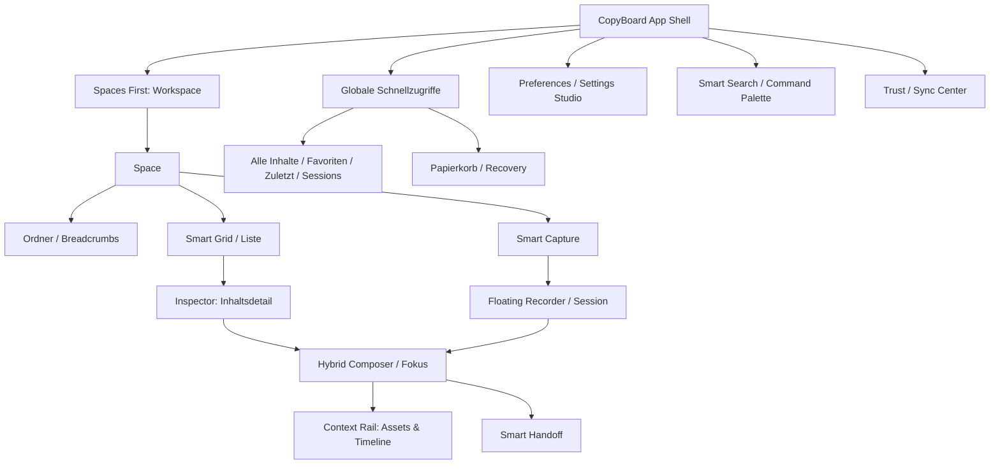

# CopyBoard — Screen Inventory & Information Architecture Blueprint 02

**Stand:** 21. Oktober 2026 · **Version:** IA-02 / Konzeptrevision v0.35  
**Referenzen:** `CopyBoard-Design-Masterplan-v0.34-2026-10-21.md`, `CopyBoard-Decision-Integrity-Audit-01-2026-10-21.md`.  
**Status:** konzeptionell spezifiziert; **keine Implementierung, keine Repository-Änderung, keine QA gegen den aktuellen Code**.

> **Wichtige Abgrenzung:** Die 33 expliziten Nutzerentscheidungen D-001 bis D-033 bleiben unverändert. Dieses Dokument integriert ihre Oberflächen und beschreibt eine **vorgeschlagene IA und Interaktionsarchitektur**. Details mit `VORSCHLAG`, `HUMAN GATE` und `TECHNICAL GATE` dürfen nicht als bereits vom Nutzer autorisiert ausgegeben werden. Die hier beschriebene IA ersetzt keine technische Sicherheitsprüfung.

## 0. Executive Summary

CopyBoard erhält **eine zusammenhängende Desktop-Shell und einen darauf abgestimmten mobilen Shell-Modus**, keine lose Ansammlung separater Apps. Die Grundhierarchie bleibt **Spaces First**. Smart Capture, Smart Grid/Liste, adaptive Inspector-Ansicht, fokussierter Hybrid Composer und Context Rail teilen denselben Inhaltskontext. Session Recorder läuft unabhängig von Navigationswechseln; Handoff, Recovery, Sync Center und Einstellungen erhalten kontrollierte sekundäre Ebenen.

**Architekturprinzipien:** (1) eine Aktion – ein Zustandsbesitzer; (2) Primärnavigation ≠ sekundäre Detailtiefe; (3) aktive Aufnahme ist eine persistente Arbeitsaktivität, kein Modal; (4) lokale Speicherung ≠ Cloud-Bestätigung; (5) keine ungefragte Weitergabe; (6) CopyBoard bleibt vor allem ein schneller Clipboard-/Capture-Workspace.

### Statusnotation

- **[BESCHLOSSEN]** aus D-001–D-033 übernommen.
- **[ABGELEITET]** notwendige Strukturkonsequenz aus mehreren Beschlüssen, keine neue Grundsatzentscheidung.
- **[VORSCHLAG]** konkrete UX-Ausführungsregel zur späteren Bestätigung.
- **[HUMAN GATE]** echter offener Produkt-/Bedienentscheid; nicht still entscheiden.
- **[TECHNICAL GATE]** muss im Architektur-/QA-Run bewiesen werden, bevor ein verlässlicher Funktionsclaim erlaubt ist.

## 1. Top-Level Information Architecture



**Navigation versus Arbeitsebene:** Die Hauptnavigation bestimmt, **welche Sammlung** der Nutzer betrachtet. Die Detailansicht bestimmt, **an welchem Inhalt** er arbeitet. Recorder, Palette und Trust Center verändern nicht still den aktiven Space.

**Globale Schnellzugriffe:** Alle Inhalte, Favoriten, Zuletzt, Sessions; Papierkorb/Recovery über passende Navigation bzw. Settings erreichbar. Exakte Position des Papierkorbs wird erst im Komponenten-Blueprint finalisiert. Ordner sind innerhalb eines Space primär über Karten und Breadcrumbs erreichbar, nicht als dauerhaft aufgeklappter Baum in der schmalen Sidebar.

## 2. Screen Inventory: Primäre Ansichten

Die `SC-*`-IDs sind **Blueprint-IDs**, keine URL-Spezifikation. Ein `SC` kann responsive dieselbe fachliche Ansicht mit anderem Layout darstellen. Die IDs sind unabhängig von D-001–D-033.

| ID | Ansicht / Zweck | Einstieg | Dominante Zone | D-Bezug | Pflichtzustände |
|---|---|---|---|---|---|
| SC-01 | App-Shell / Auth-Boundary | App-Start | Shell oder Auth-Gate | D-001/D-028 | lädt, angemeldet, abgemeldet, Daten unverfügbar |
| SC-02 | Space-Board | Space wählen | Ambient Header + Capture + Smart Grid/Liste | D-001/018/019/020 | lädt, leer, 1, viele, Fehler, offline |
| SC-03 | Space-Ordneransicht | Folder Card/Breadcrumb | Workspace-Inhaltsfläche | D-024 | leer, verschachtelt, ohne Zugriff, gelöscht |
| SC-04 | Alle Inhalte | Schnellzugriff | globales Grid/Liste | D-005/018 | 0, paginiert, gefiltert |
| SC-05 | Favoriten | Schnellzugriff | gefiltertes Grid/Liste | D-006/018 | 0, Liste, kein Treffer |
| SC-06 | Zuletzt | Schnellzugriff | temporale Inhalteansicht | D-018 | 0, viele, Filter |
| SC-07 | Sessions-Übersicht | Schnellzugriff | Session-Kartenliste | D-008/018 | 0, in Arbeit, gestoppt, unterbrochen |
| SC-08 | Space Creation | Plus bei Spaces | Studio Space Sheet | D-025 | Eingabe, Vorschau, speichert, Fehler |
| SC-09 | Living Empty State | Space ohne Inhalt | Workspace-Bühne + Smart Capture | D-026 | vor erster Sicherung, danach Grid |
| SC-10 | Item Inspector | Karte öffnen | rechtes Detailpanel | D-004/006 | lädt, Inhalt, fehlt, gesperrt |
| SC-11 | Hybrid Composer (Fokus) | Inspector / Session-Stop | zentraler Fokus-Workspace | D-007/009 | Entwurf, ändernd, speichert, Konflikt |
| SC-12 | Content Rail | Composer-Zusatzansicht | rechte Materialspalte | D-010 | Materialien, Timeline, leer, Fehler |
| SC-13 | Session Panel | Recorder ausklappen | Kontextebene/angrenzendes Panel | D-008 | läuft, pausiert, unterbrochen, stoppt |
| SC-14 | Smart Search | Suchtrigger/Shortcut | Palette / mobil Fullscreen | D-021 | leerer Query, Ergebnisse, keine, lädt, Fehler |
| SC-15 | Bulk Selection | Auswählen/Modifikator | Board plus Floating Bar | D-022 | 0, 1, n, gemischt, filterwechsel |
| SC-16 | Sort & Density Controls | Board Toolbar | kleine Popovers/Sheet | D-023/032 | Modus, Wechsel, Filter, Custom |
| SC-17 | Smart Handoff Sheet | Composer-Export | Modal-/Sheet-Ebene | D-011 | Copy, .md, ZIP, Fehler, unvollständig |
| SC-18 | Sync Center | Cloud-Indikator | Popover / Detailcenter | D-028 | lokal, pending, synced, offline, conflict, local-fail |
| SC-19 | Trash | Recovery-Einstieg | eigenständige Listen-/Gridansicht | D-029 | leer, gelöschte Inhalte, Restore, Error |
| SC-20 | Version History | Editor-Menü | Versionspanel / Fokusnebene | D-029 | Liste, Vorschau, Restore, Conflict |
| SC-21 | Quick Preferences | Kontextbutton | kleines Popover / Mobile Sheet | D-002/033 | Sidebar/Density/Theme Werte |
| SC-22 | Settings Studio | globale Settings | Settings-Workspace | D-031/032/033 | Allgemein, Darstellung, Daten, Security |
| SC-23 | Unified Context Actions | … / Rechtsklick | Popover / Context Menu | D-006 | kompatible Optionen, gesperrt, Untermenü |
| SC-24 | Mobile Main Shell | mobiles Gerät | Header + Board + Adaptive Dock | D-030 | Default, Selection, Recorder, Keyboard |
| SC-25 | Folder/Space Move Target | Move / Drag | Target-Sheet oder Drop-Overlay | D-022/023/024 | gültig, ungültig, Konflikt, Undo |
| SC-26 | Import / Backup / Legacy-Gates | Alt-Funktionsinventar | kontrollierter Utility-Screen | D-001 + Parity | Status von Alt-Funktion offen; nicht verwerfen |
| SC-27 | Content-specific Tools | Inspector/Fokus | Bild/Datei/Text-Werkzeuge | D-004 + Parity | OCR, Rotate, Flip, PIN etc. noch zu mappen |
| SC-28 | Account / Cloud Connection | Shell/Settings | Account-Screen bzw. Dialog | D-028/033 | Auth, verbunden, abgelaufen, Fehler |

**SC-26/27/28 sind Platzhalter für notwendige Funktionsparität**, keine Freigabe, bereits bestehende Auth-/OCR-/PIN-/Backup-UX ungeprüft zu ersetzen. Die ursprüngliche Feature-Inventarliste ist im nächsten Technical/Parity Gate verbindlich gegenzuprüfen.

## 3. Layer Inventory: Komponenten und Stapelung

### 3.1 Ebenenmodell

| Layer | Typische Inhalte | Grundregel | Mobile-Besonderheit |
|---|---|---|---|
| L0 Basis | App Shell, Sidebar/Drawer-Trigger, Workspace, Ambient | genau ein primärer Content-Kontext | mobile Shell statt Desktop-Rail |
| L1 eingebettet | Header, Smart Capture, Grid, aktiver Inspector **oder** Composer | inhaltlich zusammenhängend; keine doppelte Datenquelle | Detail wird Fullscreen/Sheet |
| L2 persistente Aktivität | Floating Recorder, ggf. Context-Strip | Aufnahme lebt neben der Navigation, kein Modal | eigener reservierter Dock-Bereich |
| L3 ephemere Controls | Quick Actions, Smart Selection Bar, Popovers, Tooltips | durch Fokus/Modus geöffnet, nicht alles zugleich | Safe Areas und virtuelle Tastatur |
| L4 modale Aufgaben | Handoff, bestätigtes Löschen, Space Creation, Konfliktauflösung | Fokus einfangen, Zurück/Abrüche definiert | Bottom Sheet oder Screen |
| L5 globale Palette | Smart Search / Command Palette | genau eine Palette offen, Fokus korrekt zurück | fullscreen-fähiger Search-Screen |
| L6 systemkritischer Hinweis | Speicherausfall, gefährliche Sicherheitswarnung | darf nicht von dekorativer Ebene verdeckt werden | zugänglich und persistierend |

**Kein verbindlicher CSS-`z-index`-Wert**: Dies ist eine funktionale Prioritätsordnung; technische Portal-/Stacking-Implementierung folgt später.

### 3.2 Eigentümer jeder Interaktion

- **Primärnavigation** besitzt aktive `spaceId` bzw. globale Sammlung und Breadcrumb-Ort; sie ändert keine Editor- oder Recorder-Daten ohne explizite Handlung.
- **Board** besitzt Kartensortierung, Dichte, Filter, Selection-Set und visuellen Scrollanker.
- **Inspector** besitzt die angezeigte `itemId` als Detailkontext; das Board bleibt im Hintergrund persistent.
- **Composer** besitzt `draftId`, Editor-Dokument, Markdown-Modus und seine **eigene** rechte Context Rail. Im Fokusmodus wird der normale Inspector nicht gleichzeitig als zweite rechte Detailspalte angezeigt.
- **Recorder** besitzt `sessionId`, Aufnahmestatus und zeitgestempelte Assets – **unabhängig von** `spaceId`, Inspector, Palette und Scrollposition.
- **Sync Center** beobachtet tatsächlich bestätigte Persistenzstatus, es besitzt nicht selbst die Wahrheit über erfolgreiche Writes.
- **Preferences** hat **eine** gemeinsame Quelle, unabhängig davon, ob Quick Preferences oder Settings Studio die Controls zeigen.

## 4. Räumliche Architektur nach Geräteklasse

### 4.1 Desktop — Designziel

```text
┌─────────────────────────────────────────────────────────────────────┐
│ Rail │ Workspace: Ambient / Space-Kontext / Quick Access / Sync    │
│ (D)  │ [Ambient Canvas + großes Space-Heading]                     │
│  ⇢   │ [Smart Capture Bar]                           [Search]      │
│      │ ┌─────────────────────────────┬───────────────────────────┐ │
│      │ │ Smart Grid / List           │ Inspector (bei Auswahl)   │ │
│      │ │ Folder Cards / Breadcrumbs  │ Typ-Vorschau + Aktionen   │ │
│      │ └─────────────────────────────┴───────────────────────────┘ │
│      │ Recorder unabhängig; Global-Suche, Prefs, Handoff als Layer │
└─────────────────────────────────────────────────────────────────────┘
```

- [BESCHLOSSEN] Hover-Rail temporär als Overlay, Modi kompakt/offen/dynamisch (D-002); permanenter Offen-Modus darf natürlich dedizierten Platz belegen.
- [BESCHLOSSEN] Collapsing Ambient reduziert im Scrollzustand den Hero zu einer kompakten Toolbar (D-019/020); Capture-Einstieg bleibt erreichbar, kein zweiter Capture-Store.
- [ABGELEITET] Inspector nutzt Breite nur dann, wenn eine Item-Auswahl existiert. Für Composer-Fokus bekommt der Editor Vorrang; Context Rail gehört zum Composer.
- [VORSCHLAG] Visuelle Flächen im offenen Inspector: Board flexibel, Inspector mit Min-/Max- und Resize-Regel; endgültige Pixelwerte in Design Tokens.

### 4.2 Tablet — Designziel

- [ABGELEITET] Dieselben Inhalte, aber **nicht** zwangsläufig dieselben parallelen Spalten. Rail wird kompakter; Inspector kann je nach verfügbarer Breite als großer Sheet-/Detailmodus erscheinen.
- [ABGELEITET] Split View im Composer nur, wenn der Text sinnvoll lesbar bleibt. Context Rail priorisiert sich als Sheet über einer weiterhin bearbeitbaren Editoransicht, statt drei Spalten zu erzwingen.
- [TECHNICAL GATE] Touch, externe Tastatur, iPad Split-Screen/Stage Manager, Zoom und Hardware-Keyboard-Zustände auf realen Browsern prüfen.

### 4.3 iPhone / schmales Touchlayout — Designziel

```text
┌─────────────────────────────┐
│ Space Titel        Sync     │
│ Ambient + Compact Header    │
│ Smart Grid / List           │
│ (volle Breite)              │
│                             │
│ Kontext-Strip falls aktiv   │
│ ─────────────────────────── │
│ Spaces │ Suche │ + │ Mic    │  Adaptive Mobile Dock
└─────────────────────────────┘
```

- [BESCHLOSSEN] Adaptive Dock hält `Spaces`, `Suche`, `Capture` als Hauptaktionen stabil; Recorder/Selection treten **zusätzlich** kontextabhängig auf, ohne essentielle Aktionen zu entfernen (D-030).
- [ABGELEITET] Sidebar als Tap-Drawer; Search als großflächiges Palette-/Fullscreen-Sheet; Inspector als Detailscreen; Composer einspaltig; Context Rail als Material-Drawer.
- [ABGELEITET] Ein aktiver Recorder darf nie hinter Auswahlbar oder virtueller Tastatur versteckt werden. Es gibt auf Mobil nur einen **sichtbaren** kontextuellen Aktionsstrip zur Zeit; seine Inhalte können Session und Auswahl anzeigen, ohne zwei übereinander schwebende Leisten zu stapeln.
- [TECHNICAL GATE] Hintergrund-Audio in Mobile Browser/PWA ist nicht garantiert. Keine irreführenden Aufnahmekontinuitäts-Claims; Permission-/Interruptions-State sichtbar.

### 4.4 Responsive Regel

**Keine fixen Breakpoints beschlossen.** Der spätere Token-/Component-Run wählt Grenzen auf Grundlage benötigter Mindestbreite, Zoom, Landscape, virtueller Tastatur und Bedienhilfen; ein nominelles Geräteetikett allein ist kein zuverlässiger Layoutparameter.

## 5. Zustandsmodell: Wahrheit, Scope und Lebensdauer

### 5.1 Orthogonale Zustandsbereiche

| Bereich | mögliche Zustände | Lebensdauer |
|---|---|---|
| Navigation | `space` / `folder` / `global-collection` / `settings` / `trash` | History-/Route-Kontext |
| Darstellung | `board-grid` / `board-list`, `comfort` / `standard` / `compact` | persistente Preference |
| Detail | `none` / `inspector(itemId)` / `composer(draftId)` / `media-focus` | Fokus-/Navigationstiefe |
| Session | `none` / `requesting` / `recording` / `paused` / `interrupted` / `stopping` / `saved` / `failed` | globale Aktivität im App-Lebenszyklus |
| Selection | `inactive` / `active(empty)` / `active(n)` | Board-Kontext, kein globaler Datenmutator |
| Suche | `closed` / `open(query, filters)` | temporärer Overlaykontext |
| Save | `dirty` / `saving-local` / `local-committed` / `local-failed` | pro Revision |
| Cloud | `not-configured` / `queued` / `syncing` / `server-ack` / `offline` / `conflict` / `error` | pro Revision/Scope |
| Operation | `idle` / `pending` / `committed` / `failed` / `undo-available` | pro Aktion |
| Preferences | `theme`, `sidebarMode`, `density` und räumliche Geltung | persistente Quelle |

**Invariante:** `session.recording` kann parallel zu `board`, `inspector`, `search` und **Selection** existieren, sofern die jeweilige Plattformaufnahme weiterhin aktiv ist. Dagegen schließen sich `inspector`-rechtes Detailpanel und `composer`-eigene Context Rail **als konkurrierende rechte Hauptspalten** aus.

### 5.2 Navigation & Zurück-Verhalten

| Ausgang | Aktion | Ziel | verbindlich oder Vorschlag |
|---|---|---|---|
| Space-Board | Datei-/Textkarte öffnen | Inspector desselben Items | [BESCHLOSSEN] D-004/D-006 |
| Space-Board | Ordnerkarte öffnen | **Human Gate H-01** | [OFFEN] D-004 vs. D-024; Vorschlag Ordner-Navigation |
| Inspector | Bearbeiten / Fokus | Hybrid Composer (gleiche Item-Referenz) | [ABGELEITET] |
| Composer | Material öffnen | Context Rail / Asset Preview, Draft bleibt | [BESCHLOSSEN] D-010 |
| Composer | Handoff | Sheet über Entwurf | [BESCHLOSSEN] D-011 |
| Session stoppt und Originale gesichert | Composer öffnen | an Session verknüpfter neuer/fortgesetzter Draft | [BESCHLOSSEN] D-009 |
| Search | Treffer wählen | referenzierter Space/Ordner + Inspector | [VORSCHLAG] Back zur Suche inkl. Query |
| Folder | Breadcrumb-Elternknoten | Elternordner/Space | [BESCHLOSSEN] D-024 |
| Navigation | Zurück | vorheriger sichtbarer Kontext + Scrollanker | [VORSCHLAG], Detailkontrakt offen |
| Composer/Inspector | Esc/Back | genau eine Ebene zurück, Entwurf erhalten | [VORSCHLAG], Escape-Priorität offen |

### 5.3 Was nach einer neuen Speicherung passieren darf

1. Capture-Operation beginnt, keine Speicherbestätigung vorgaukeln.
2. Local Write mit eindeutiger Operation-/Item-ID versuchen.
3. Bei tatsächlichem Durable Commit: **lokal gespeichert** und räumlicher Capture-Handoff zum wirklichen Kartenort (D-027).
4. Cloud-Queue zeigt pending/offline; **server-ack** erst nach bestätigter passender Revision (D-028).
5. Bei local-failed: Fehlerzustand; kein grüner Haken, kein Weganimieren als angeblich gespeicherter Inhalt.
6. Undo/Recovery müssen idempotent/konfliktfest sein; Wiederherstellen als neue Revision ist Zielvertrag, aber Datenmodell technisch zu belegen (D-029).

## 6. Interaktionskonflikte — konkrete Kontrakte

### IC-01 · Primäraktion Ordnerkarte [HUMAN GATE H-01]

- **Problem:** D-004 „Karte öffnet Inspector“ gegen D-024 „Ordnerkarte öffnet Ordner“.
- **Vorgeschlagene Auflösung:** Item-Datei/Text/Bild/Audio öffnet Inspector; Ordnerkarte navigiert in Ordner. Ordnerdetails über `… > Informationen` oder Kontextmenü. `Enter` auf fokussierter Ordnerkarte öffnet Ordner; Auswahlmodus hat Vorrang.
- **Warum nur Vorschlag:** Es ist ein echter ursprünglicher Bedeutungswiderspruch; nicht ohne ausdrückliche Zustimmung als endgültig markieren.
- **Prüfkriterium:** identisches Verhalten in Grid/List, Desktop/Touch/Keyboard und Browser-Back.

### IC-02 · Inspector gegen Composer/Context Rail [ABGELEITET + VORSCHLAG]

- Normaler Board-Inspector und Composer-Rail benutzen keine unkoordinierten rechten Doppelspalten.
- [VORSCHLAG] Übergang `board → inspector → composer`, rückwärts `composer → inspector → board`, mit Fokus- und Scroll-Restoration.
- Kein Verwerfen eines ungesicherten Drafts beim Schließen; Save-Status ist autoritativ.

### IC-03 · Capture vs. Editor-Paste [BESCHLOSSEN + TECHNICAL GATE]

- Bei Editor-/Eingabefokus gehört `Cmd/Ctrl+V` dem fokussierten Feld/Editor; im nichteditierenden Board-Kontext löst es Capture aus.
- [VORSCHLAG] Binäre Clipboard-Daten in Composer werden als explizit verbundener Attachment-Ingest verarbeitet, nicht still global ins Board umgeleitet.
- Copy-Verhalten pro MIME-Typ verifizieren; Browserberechtigungen, Clipboard-Fallback und Duplikate nicht durch Animation kaschieren.

### IC-04 · Auswahl, Drag, Reorder, Move [BESCHLOSSEN + VORSCHLAG]

- Normalmodus: Kartenfläche = Öffnen (außer Ordner-Gate); Copy-Icon = Kopieren; `…`/Rechtsklick = Actions.
- Auswahlmodus: Kartenfläche = Toggle; keine doppelte Öffnung; Bulk Bar bei ≥1 Item.
- `Cmd/Ctrl+Klick` addiert/entfernt, `Shift+Klick` wählt Bereich der **sichtbaren** Reihenfolge. Bei virtuellen/nachgeladenen Items und Filterwechsel ist Selection-Policy explizit zu zeigen.
- Drag im **manuellen Sortiermodus** darf die gespeicherte Reihenfolge ändern; im automatischen Sortiermodus **nicht still** die manuelle Reihenfolge umschreiben.
- [VORSCHLAG] Drag auf klar unterscheidbare Ordner-Ziele = Move mit Vorschau/Undo; Blockierung bei zyklischem Folder-Move.

### IC-05 · Recorder + Mobile Dock + Selection-Bar [VORSCHLAG]

- Aufnahme ist globale Aktivität und bleibt in allen Collection-/Inspector-Ansichten sichtbar, nicht an eine Modal-Lebensdauer gebunden.
- Auf Mobile bleibt das Hauptdock räumlich stabil; darüber **ein kontextueller Bereich**, der bei Recording+Selection priorisiert die Aufnahmeindikatoren und ergänzend Selection-Anzahl/Shortcut anbietet – niemals die Stop-/Fehlersteuerung verstecken.
- Wenn virtuelle Tastatur öffnet, docken kontextuelle Elemente um; sie dürfen Eingaben/Undo und systemeigene Safe Areas nicht blockieren.
- Optionales Desktop-Capture-Dock ist weiterhin **nur vorgemerkt**, nicht automatisch Baseline.

### IC-06 · Smart Search & Editor-Shortcuts [VORSCHLAG]

- Suchpalette bekommt eine globale zugängliche Aktion (Header/Dock), Keyboard-Shortcut nur nach Test der Editor- und Browser-Konflikte.
- `Cmd/Ctrl+K` ist im Hybrid Composer potentiell Link-Einfügen: kein implizites Übersteuern. Pro Focus-Scope ein eindeutiger Shortcut-Owner und eine anklickbare Suchalternative.
- `Escape` schließt die oberste **schließbare** Ebene, darf niemals Aufnahme beenden oder ungesicherte Daten verlieren.

### IC-07 · Sticky Header & Smart Capture [BESCHLOSSEN + VORSCHLAG]

- Ambient-Collapse scrollgetrieben; Quick-Capture in Sticky Toolbar ruft dieselbe Capture-Logik auf wie die große Bar.
- [VORSCHLAG] Während der Nutzer im Capture-/Editor-Feld tippt, bleibt dessen DOM/Fokus-Owner stabil. Scroll-Collapse verändert Darstellung, nicht das Input-Element oder den Draft.
- Restore nach Back/Space-Wechsel ohne springende Headerhöhe oder verlorenen Scrollanker.

### IC-08 · Preferences Scopes [VORSCHLAG]

| Preference | Vorschlag für Scope | Begründung / offene Prüfung |
|---|---|---|
| Theme Hell/Dunkel/System | Konto oder lokal mit lokaler Vorrangregel | Geräte können unterschiedliche System-Themes haben |
| Sidebar kompakt/offen/dynamisch | pro Gerät/Bildschirmklasse | Mobile kennt keinen Hover; ein globaler Mode würde kollidieren |
| Kartendichte | pro Gerät, optional pro Space | kompakte Ansicht am Desktop ≠ passende Mobile-Dichte |
| Aktuelle Sortierung | pro Space bzw. Collection | manuelle Ordnung selbst ist eine Inhalts-Eigenschaft |
| Manuelle Item-Reihenfolge | pro Space/Ordner, synchronisierbar | kein Preference-Kippzustand, sondern geordnete Inhalte |
| Space Accent/Icon | Space-Metadaten, synchronisierbar | identische Space-Identität zwischen Geräten |
| Breite Inspector/Context Rail | lokal pro Gerät/Bildschirm | abhängig von verfügbaren Pixeln |

**Keine finale Festlegung von Persistenzort, Konfliktpolitik oder Account-Scope.** Quick Preferences und Settings Studio verwenden denselben Preferences-Datensatz (D-033).

### IC-09 · Ordnerbewegung, Assets, Pins & Trash [TECHNICAL GATE]

- Inhalt/Folder benötigt stabile IDs unabhängig vom Anzeige-Namen und von der visuellen Position.
- Folder-Zyklen verhindern; Pin als Verweis, nicht als duplizierte Kopie.
- Bestehende Composer-/Markdown-/ZIP-Assets nach Rename/Move/Restore korrekt auflösen oder sichtbar als defekt anzeigen – niemals still verlieren.
- Trash von Eltern mit Kindobjekten inkl. Assets und spätere Wiederherstellung auf realistische Storage-Grenzen testen.

### IC-10 · Filter, Suche, Mehrfachauswahl und Empty States [ABGELEITET + VORSCHLAG]

- „Space leer“, „Ordner leer“ und „Suche hat keine Treffer“ sind unabhängige UI-Zustände. D-026-Living-Empty-State ist **nur** für tatsächlich leere Spaces bzw. definierte First-Run-Kontexte, nicht als Fehler- oder Such-Fallback gedacht.
- [VORSCHLAG] Wenn ein aktiver Filter ausgewählte Karten ausblendet, zeigt die Floating Action Bar **sichtbare und insgesamt ausgewählte Anzahl getrennt** an; Aktionen auf verborgenen Karten erfordern explizite Bestätigung oder eine verständliche Auswahlbereinigung. Kein stilles Mitbearbeiten.
- Beim Wechsel von Grid zu Liste oder Dichte/Sortierung bleibt die Auswahlmenge an **stabile Item-IDs** gebunden und nicht an Listenpositionen. `Shift`-Ranges werden nach sichtbarer, aktueller Reihenfolge bestimmt.
- [TECHNICAL GATE] Tests mit 0/1/100/10.000 Items, Zoom, Lazy Loading, Virtualisierung und Keyboard-Fokus; kein mehrfaches Layout-Morphing beim Nachladen.

## 7. Zustandsinventar jenseits des Happy Paths

| Bereich | Leerer Zustand | Lädt | Fehler | Offline | Konflikt/Recovery |
|---|---|---|---|---|---|
| Space-Board | Living Empty State (nur wenn wirklich 0 Items) | Skeleton | Loading-Fehler | lokal verfügbar/Status | gelöschter Space/Revision |
| Globale Sammlung | keine Items | Skeleton | Query-Fehler | vorhandene lokale Daten | unsichtbare ausgewählte Items |
| Suche | leerer Query / keine Treffer getrennt | debounced Loading | Index-Fehler | Indexumfang kennzeichnen | Ergebnis geändert/gelöscht |
| Smart Capture | Einladung zur Eingabe | Saving | **local write failed** | lokale Speicherung ggf. möglich | Duplikat/Kollision |
| Inspector | „kein Item“ oder entfernt | Vorschau-Laden | File-Decoder fail | Asset nur lokal | Item veraltet/editiert |
| Composer | Empty Draft | Datei/Preview-Render | Save fail | Draft lokal | Revision Conflict + Export |
| Session | noch keine Aufnahme | Mikrofonberechtigung | Permission/Encoding fail | Aufnahme soweit Browser erlaubt | unterbrochene/teilgesicherte Session |
| Handoff | keine Assets | Bundle bereiten | ZIP/Asset fail | lokales Bundle möglich | fehlendes Asset klar melden |
| Trust Center | Cloud nicht eingerichtet | Syncing | lokaler Speicherfehler | Pending | Versionskonflikt |
| Trash/Versions | leer/keine Revisionen | Restore prüfen | Recovery fail | lokale Daten begrenzt | Restore-Kollision |
| Settings | Default | Preferences laden | nicht gespeichert | lokale Fallbacks prüfen | abweichende Account-Preferences |

**Unterscheidung:** „Leerer Space“ (D-026) ≠ „kein Suchtreffer“ (D-021) ≠ „kein Zugriff“ ≠ „Assets nicht geladen“ ≠ „gespeicherte Daten nicht lesbar“. Nichts davon darf durch denselben freundlich illustrierten Empty State verdeckt werden.

## 8. Accessibility und Motion als Querschnittsvertrag

- Jede Funktion muss ohne Hover verfügbar sein; zugängliche Namen/Labels für Icon-Rail, Floating Bar, Sync-Symbol und Recorder.
- Fokus wandert beim Öffnen einer Palette/eines Sheets kontrolliert hinein und nach Schließen zurück. `Escape` darf keine existenzielle Aufnahme oder unsichere Datenlöschung auslösen.
- Reduced Motion: keine bedeutungsverlierende Choreografie; Capture-Ziel und Save-/Cloudstatus bleiben **in Text** nachvollziehbar.
- Keyboard/Touch: Copy, Öffnen, Auswählen, Move, Suchtreffer, Zurück und Materialeinfügen mit gleichwertigen Wegen.
- Zoom, große Schrift, Safe Areas und dynamische Bildschirmtastatur sind **Layoutzustände**; nicht bloß nachträgliche QA-Sonderfälle.
- Farbkontrast in Lavender Bokeh, Space-Tints und Dark Mode; Statusinformationen nie ausschließlich durch Farbe.
- Sichtbare Bestätigung und Fehlermeldungen per Screenreader angemessen annoncieren, ohne alle Mikrovorgänge störend auszurufen.

## 9. Szenario-Matrix für späteren Integrationstest

| Test-ID | Szenario | Akzeptanzkern |
|---|---|---|
| IA-QA-01 | Space wählen, Folder öffnen, zurück | Breadcrumb, Board-Scroll und aktiver Space konsistent; H-01 vorher freigeben |
| IA-QA-02 | Karte → Inspector → Composer → Context Rail → zurück | keine doppelte rechte Detailspalte, Draft und Fokus erhalten |
| IA-QA-03 | Aufnahme läuft, Space wechseln, Material öffnen, Screenshot anhängen | Recorder bleibt erreichbar, Zeitstempel korrekt, keine unbemerkte Unterbrechung |
| IA-QA-04 | Aufnahme stoppen und lokalem Save absichtlich Fehler zufügen | kein automatisches „fertig“, ungesicherten Kontext nicht verwerfen |
| IA-QA-05 | `Cmd/Ctrl+V` im Board vs. Composer vs. Suche | nur richtiger Fokus-Eigentümer verarbeitet Paste |
| IA-QA-06 | Mehrfachauswahl über Sortierung/Grid/List | keine stille Auswahlverschiebung, richtig sichtbare Anzahl |
| IA-QA-07 | Drag im manuellen vs. automatischen Sortiermodus | manuelle Reihenfolge nur explizit mutiert |
| IA-QA-08 | Bulk-Bar + Recording + Dock auf iPhone | keine Überlagerung von Kernsteuerung oder virtueller Tastatur |
| IA-QA-09 | Scroll-Collapse bei Capture-Fokus | keine Remount-/Caret- oder Scrollsprünge |
| IA-QA-10 | Offline Capture, dann Reconnect | lokaler Commit und Cloud ACK korrekt getrennt |
| IA-QA-11 | Storage Quota voll | kein grünes Save, Fehler sichtbar, rettbarer Entwurf |
| IA-QA-12 | Suche ohne Treffer vs. wirklich leerer Space | unterschiedliche Leerzustände |
| IA-QA-13 | Handoff ZIP mit Bild/Datei und Audio opt-in | alle erwarteten binären Dateien im Bundle; keine automatische Drittweitergabe |
| IA-QA-14 | Version wiederherstellen, dann Undo/Revision ansehen | bisher aktueller Stand nicht vernichtet |
| IA-QA-15 | Ordner verschieben, Pin und Asset-Referenz prüfen | keine Zyklen/verwaisten Pfade |
| IA-QA-16 | Suche und Editor gleichzeitig; `Cmd/Ctrl+K`/Esc | vorher festgelegte Shortcut-Priorität ohne Konflikt |
| IA-QA-17 | Theme/Sidebar/Density Quick und Studio ändern | ein gemeinsamer Preference-Wert, auf passendem Device-Scope |
| IA-QA-18 | Screenreader + Keyboard + Reduced Motion | alle Kernaktionen erreichbar; keine animationserzwungene Bedienung |
| IA-QA-19 | 0, 1, 100, 10.000 Items; Desktop/Tablet/Mobile | stabiler Fokus, Filter, Virtualisierung, keine hektischen Layoutsprünge |
| IA-QA-20 | Legacy-Dateien/Backup/OCR/PIN/Bildrotation | vorhandene Fähigkeiten im Parity-Gate ausdrücklich erhalten oder freigegeben ersetzt |

## 10. Human-Gates, Empfehlungen und nächste Blueprint-Stufe

### Human Gates, die **nicht** als bereits beschlossen gelten

1. **H-01 (zwingend):** Primäraktion auf Ordnerkarten. **Empfehlung:** Klick/Tap öffnet Ordner, `… > Informationen` liefert Details. Alternative Inspector zuerst bleibt bis Nutzerfreigabe offen.
2. **H-02 (Interaction Blueprint):** Vollständige `Escape`-/Browser-Back-/Command-Shortcut-Priorität im Composer (insbesondere `Cmd/Ctrl+K`). Nicht aus Demo-Konventionen automatisch zum Vertrag erklären.
3. **H-03 (Technical Blueprint):** genaue Preference-Scopes & Sync/Storage-Orte, Audio-Unterbrechungen, sichere Wiederherstellungsaufbewahrung; keine Behauptung bestehender Machbarkeit.

### Fest verknüpfte kritische Freigabebedingungen

- **P0-01 bis P0-05** aus `CopyBoard-Decision-Integrity-Audit-01-2026-10-21.md` bleiben vollständig offen, bis ein separater Code-/Architektur-/Browser-QA-Lauf Nachweise liefert.
- Alt-CopyBoard-Feature-Parity vor dem Entfernen irgendeiner Funktion: OCR, Bildrotation/-spiegelung, PIN, Backups/Import/Export, Duplikaterkennung, Favoriten, Cloud Auth, Dateiformate und Mobile-Aktionen.
- Keine sensitive Nutzerdatei als ungeschützte Testprobe, keine automatische KI-/Agentweitergabe, keine fiktiven Success-/Sync-Stati.

### Ergebnis und nächster Schritt

**IA-Spezifikation definiert:** 28 vorläufig identifizierte fachliche Screen-/View-Kontexte (`SC-01..SC-28`), sechs Kern-Layerebenen plus systemkritische Meldungen, durchgängige Responsive-Verträge, zehn State-Bereiche, zehn benannte Interaktionskonflikte/-regeln und 20 künftige QA-Szenarien. **Nicht final freigegeben:** Folder-Primäraktion, Shortcut-Semantik, Breakpoints/Tokens sowie technische Storage-/Cloud-/Recorder-Umsetzbarkeit.

**Empfohlener nächster Blueprint:** `Interaction Contract & Motion State Machines 03` mit detailliertem Layer- und Fokus-Stack, Capture/Selection/Recorder-Staten, Escape-Priorität, Motion-Storyboards und Reduced Motion; anschließend visuelle Tokens/Komponenten und Tech-/Parity-Gate. **Keine Implementierung vor separater Freigabe.**
